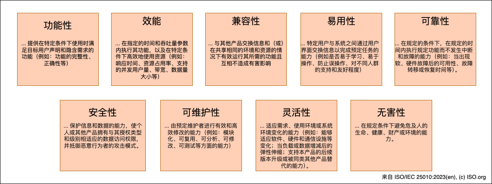
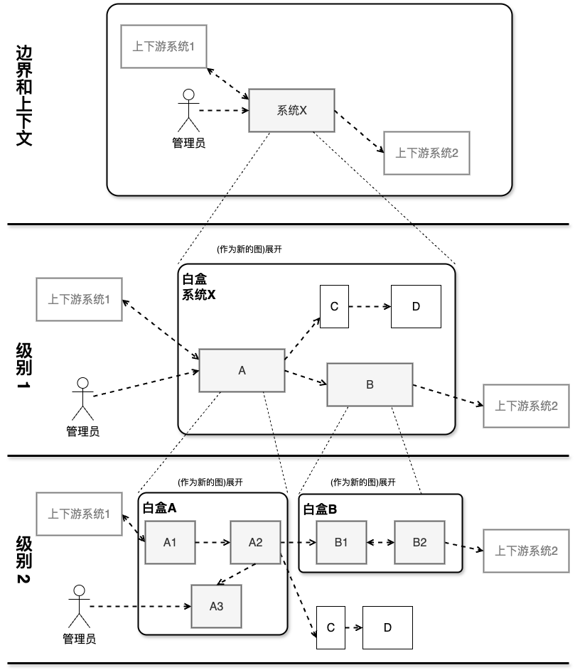
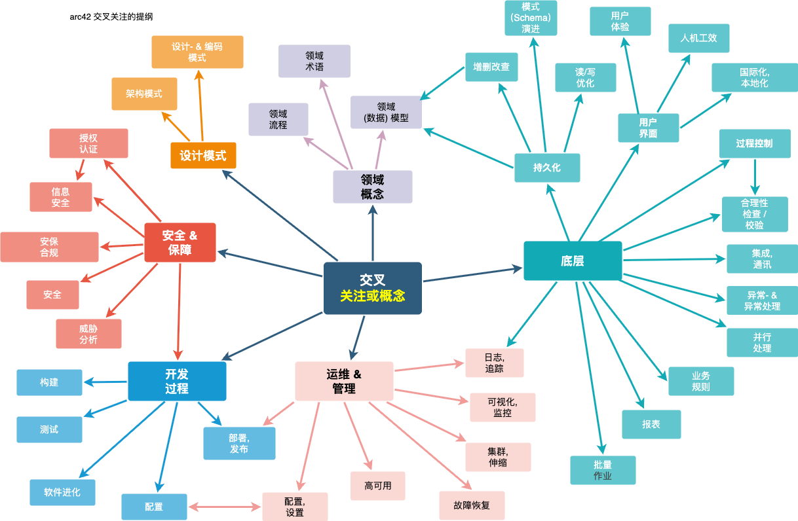

# 

**关于 arc42**

arc42，软件和系统架构文档模板。

模板版本 9.1-ZH。(基于 AsciiDoc 版本)，10月 2026

由 Dr. Peter Hruschka、Dr. Gernot Starke 及贡献者创建、维护和版权所有。
参见 <https://arc42.org> 。

:::::: sidebar
::: title
:::

:::: note
::: title
:::

此模板版本包含一些帮助和说明。它用于熟悉 arc42 以及理解概念。
对于您自己的系统文档，最好使用 *纯文本* 版本。
::::
::::::

# 引言与目标 {#section-introduction-and-goals}

:::: sidebar
::: title
:::

描述软件架构师和开发团队必须考虑的相关要求和动机,这些包括:

- 潜在的业务目标,

- 关键特性，

- 基本功能需求，

- 架构的质量目标以及相关干系人及其期望
::::

## 需求概述 {#_需求概述}

:::::::::::: sidebar
::: title
:::

:::: formalpara
::: title
内容
:::

功能需求、动机、需求的摘要（或抽象）的简短描述。
链接到（现有的）需求文档（带有版本号和存放位置）。
::::

:::: formalpara
::: title
动机
:::

从最终用户的角度来看，创建或修改系统是为了改进对业务活动的支持和/或提高质量。
::::

:::: formalpara
::: title
形式
:::

简短的文本描述，可能采用表格用例格式。
如果需求文档存在，此概述应引用这些文档。
::::

保持这些摘录尽可能简短。在本文档的可读性与需求文档的潜在冗余之间取得平衡。

:::: formalpara
::: title
更多信息
:::

参见 arc42 文档中的 [引言与目标](https://docs.arc42.org/section-1/).
::::
::::::::::::

## 质量目标 {#_质量目标}

:::::::::: sidebar
::: title
:::

:::: formalpara
::: title
内容
:::

架构需要满足主要干系人的最重要的前三个（最多五个）质量目标.
我们真正指的是架构的质量目标。不要将它们与项目目标混淆，二者不一定相同.
::::

考虑以下潜在主题概述 (基于 [ISO
25010:2023](https://www.iso.org/obp/ui/#iso:std:iso-iec:25010:ed-2:v1:en)
标准):

如需更全面（且开放）的质量特性、定义和需求示例集合，请参见 [Q42
质量模型](https://quality.arc42.org)。

:::: formalpara
::: title
动机
:::

您应该了解最重要干系人的质量目标，因为它们将影响基本的架构决策。
确保对这些质量要求非常具体，避免流行语。
如果您作为架构师不知道如何评判您工作的质量...​
::::

:::: formalpara
::: title
形式
:::

包含质量目标和具体场景的表格，按优先级排序
::::
::::::::::

## 干系人 {#_干系人}

:::::::::: sidebar
::: title
:::

:::: formalpara
::: title
内容
:::

系统干系人的明确概述，即所有人员、角色或组织：
::::

- 应当了解架构的人

- 必须信任架构的人

- 必须依赖架构或代码开展工作的人

- 依赖架构文档工作的人

- 对系统或系统的开发必须做决策的人

:::: formalpara
::: title
起因
:::

您应该了解参与系统开发或受系统影响的所有各方,否则在开发过程的后期，您可能会遇到令人不快的意外。
这些干系人决定了您工作及其结果的范围和详细程度。
::::

:::: formalpara
::: title
形式
:::

包含角色名称、人员姓名以及他们对架构及其文档期望的表格。
::::
::::::::::

+--------------+---------------------------+---------------------------+
| 角色/姓名    | 联系方式                  | 期望                      |
+==============+===========================+===========================+
| *\<角色-1\>* | *\<联系方式-1\>*          | *\<期望-1\>*              |
+--------------+---------------------------+---------------------------+
| *\<角色-2\>* | *\<联系方式-2\>*          | *\<期望-2\>*              |
+--------------+---------------------------+---------------------------+

# 架构约束 {#section-architecture-constraints}

:::::::::::: sidebar
::: title
:::

:::: formalpara
::: title
内容
:::

任何约束软件架构师在设计和实现决策自由度或开发过程决策的需求。这些约束有时超越个别系统，对整个组织和公司都有效。
::::

:::: formalpara
::: title
动机
:::

架构师应该明确知道他们在设计决策中的自由度在哪里，以及必须遵守约束的地方。
尽管约束是可以协商讨论的，但必须始终受到关注。
::::

:::: formalpara
::: title
形式
:::

带有解释的简单约束表格。
如有需要，您可以结合实践将其细分为：技术约束、组织和政治约束以及约定（例如编程或版本控制指南、文档或命名约定）
::::

:::: formalpara
::: title
更多信息
:::

参见 arc42 文档中的 [架构约束](https://docs.arc42.org/section-2/)。
::::
::::::::::::

# 上下文和边界 {#section-context-and-scope}

:::::::::::: sidebar
::: title
:::

:::: formalpara
::: title
内容
:::

系统边界和上下文，顾名思义就是将您的系统（即边界范围）与其所有通信方（周边系统和用户，即您系统的上下文）界定清晰。因此，它决定了外部接口的设计。
如有必要，请区分业务上下文（特定领域的输入和输出）和技术上下文（信道、协议、硬件）。
::::

:::: formalpara
::: title
动机
:::

与通信方的领域接口和技术接口是系统最关键的部分，请确保您完全了解它们
::::

:::: formalpara
::: title
形式
:::

有以下几种选择:
::::

- 下文关系图

- 通信方及其接口列表

:::: formalpara
::: title
更多信息
:::

参见 arc42 文档中的 [上下文和边界](https://docs.arc42.org/section-3/)。
::::
::::::::::::

## 业务上下文 {#_业务上下文}

:::::::::: sidebar
::: title
:::

:::: formalpara
::: title
内容
:::

**所有**
通信方（例如：用户、IT系统等）的规范，并解释特定领域的输入和输出或接口。
您可以选择添加特定领域的格式或通信协议。
::::

:::: formalpara
::: title
动机
:::

所有干系人都应该了解哪些数据在系统间流转。
::::

:::: formalpara
::: title
形式
:::

将系统显示为黑盒并指定与通信方的域接口的各种图表。
或者您可以（另外）附加一个表格。
此外，您还可以使用表格。表格的标题为系统名称，表格内容包含三列，分别是通信方名称、输入和输出。
::::
::::::::::

**\<图表或表格\>**

**\<可选：外部领域接口的解释\>**

## 技术上下文 {#_技术上下文}

:::::::::: sidebar
::: title
:::

:::: formalpara
::: title
内容
:::

技术接口（信道和传输介质）将您的系统与其环境连接起来。此外，将特定领域的输入/输出映射到信道上，即解释哪些输入/输出使用哪些信道。
::::

:::: formalpara
::: title
动机
:::

许多干系人基于系统与其上下文之间的技术接口做出架构决策。特别是基础设施或硬件设计师决定这些技术接口。
::::

:::: formalpara
::: title
形式
:::

例如，描述信道到相邻系统的 UML
部署图，以及展示信道与输入/输出之间关系的映射表。
::::
::::::::::

**\<图表或表格\>**

**\<可选：技术接口的解释\>**

**\<输入、输出与信道之间的映射关系\>**

# 解决方案策略 {#section-solution-strategy}

:::::::::::: sidebar
::: title
:::

:::: formalpara
::: title
内容
:::

塑造系统架构的基本决策和解决方案策略的简短总结和解释。它包括
::::

- 技术决策

- 关于系统顶层分解的决策，例如使用架构模式或设计模式

- 关于如何实现关键质量目标的决策

- 相关的组织决策，例如选择开发过程或将某些任务委托给第三方。

:::: formalpara
::: title
动机
:::

这些决策构成了您架构的基石。它们是许多其他详细决策或实现规则的基础。
::::

:::: formalpara
::: title
形式
:::

做出的决策的起因，以及为什么做出这样的决定，
基于问题陈述、质量目标和关键约束。请参阅以下章节中的详细信息（第5节是结构细节，第8节是跨领域概念）。
::::

:::: formalpara
::: title
更多信息
:::

参见 arc42 文档中的 [解决方案策略](https://docs.arc42.org/section-4/)。
::::
::::::::::::

# 构建块视图 {#section-building-block-view}

:::::::::::: sidebar
::: title
:::

:::: formalpara
::: title
内容
:::

构建块视图显示系统静态分解为构建块（模块、组件、子系统、类、接口、软件包、库、框架、层、分区、层、函数、宏、操作、数据结构...​...​）及其依赖关系（关系、关联...​...​）
此视图对每个架构文档都是必需的。 相当于房子的 *平面图*。
::::

:::: formalpara
::: title
动机
:::

通过抽象使源代码结构可理解，保持对源代码的概览。
这允许您在抽象层面与干系人沟通，而不披露实现细节。
::::

:::: formalpara
::: title
形式
:::

构建块视图是黑盒和白盒的层次集合（见下图）及其描述。
::::

- 黑盒：重点描述单个构建块的责任和接口, 不暴露内部实现

- 白盒：通常通过图表和一些文本来解释"更高层级的黑匣子"的内部结构和内部接口。

**级别1** 是整个系统的白盒描述以及所有包含构建块的黑盒描述。

**级别2**
展开\"级别1\"的某些构建块。它包含1级选定构建块的白盒描述，以及其内部构建块的黑盒描述。

**级别3** （上图中未体现）展开\"级别2\"的选定构建块，以此类推。

> 在上图中，每个圆角矩形代表一个白盒，该白盒应由白盒模板的一个图标来记录。在具体的文档中，您不需要在单个图表中展示整个层次结构！

:::: formalpara
::: title
更多信息
:::

参见 arc42 文档中的 [构建块视图](https://docs.arc42.org/section-5/)。
::::
::::::::::::

## 整体系统 {#_整体系统}

:::: sidebar
::: title
:::

在这里，您使用以下白盒模板描述整个系统的分解。它包含

- 概览图

- 分解的动机

- 包含构建块的黑盒描述。为此我们为您提供替代方案：

  - 使用 *一个* 表格进行简短和实用的所有包含构建块及其接口的概览

  - 根据黑盒模板（见下文），使用构建块的黑盒描述列表。根据您选择的工具，此列表可以是子章节（在文本文件中）、子页面（在
    Wiki 中）或嵌套元素（在建模工具中）。

- （可选）重要接口，这些接口在构建块的黑盒模板中没有解释，但对于理解白盒非常重要。

由于描述接口的方法有很多，我们不提供具体的接口模板。
在最坏的情况下，您必须指定和描述语法、语义、协议、错误处理、限制、版本、质量、必要的兼容性以及许多其他内容。
在理想情况下，您可能只需要通过示例或简单的签名就能解决问题。
::::

***\<概览图\>***

动机

:   *\<文字说明\>*

包含的构建块

:   *\<包含构建块（黑盒）的描述\>*

重要接口

:   *\<对于重要接口的描述\>*

:::: sidebar
::: title
:::

插入你对第一层黑盒的说明:

如果您使用表格形式，您将仅根据以下模式描述具有名称和职责的黑黑盒：

+----------------------+-----------------------------------------------+
| **名称**             | **职责**                                      |
+======================+===============================================+
| *\<黑盒 1\>*         | *\<文字说明\>*                                |
+----------------------+-----------------------------------------------+
| *\<黑盒 2\>*         | *\<文字说明\>*                                |
+----------------------+-----------------------------------------------+

如果你使用黑盒描述列表，那么你需要为每个重要的构建块填写一个单独的黑盒模板。它的标题就是黑盒的名称。
::::

### \<黑盒 1\> {#_黑盒_1}

:::: sidebar
::: title
:::

这里您可以根据以下 *黑盒模板* 描述\< 黑盒 1\>

- 目的/责任

- 接口列表（当它们未提取为单独的段落时）。这些接口可能包含质量和性能特征。

- （可选）黑盒的质量/性能特征，例如可用性、运行时行为等。

- （可选）目录/文件路径

- （可选）已满足的要求（如果您需要对要求的可追溯性）。

- （可选）未解决的问题/问题/风险
::::

*\<目的/责任\>*

*\<接口列表\>*

*\<（可选）质量/性能特征\>*

*\<（可选）目录/文件路径\>*

*\<（可选）已满足的要求\>*

*\<（可选）未解决的问题/难题/风险\>*

### \<黑盒 2\> {#_黑盒_2}

*\<黑盒模板\>*

### \<黑盒 n\> {#_黑盒_n}

*\<黑盒模板\>*

### \<接口 1\> {#_接口_1}

...​

### \<接口 m\> {#_接口_m}

## 级别2 {#_级别2}

:::: sidebar
::: title
:::

在这里，您可以将\"级别1\"中的（一些）构建块的内部结构作为白盒进行详细描述。
你必须选出系统中足够重要的构建块，以证明如此详细的描述是合理的。
请选择相关性而非完整性。指定重要、令人意外、有风险、复杂或不稳定的构建块。
暂时忽略系统中正常、简单、无聊或标准化的部分
::::

### 白盒 *\<构件块 1\>* {#_白盒_构件块_1}

:::: sidebar
::: title
:::

...​描述 *构建块 1* 的内部结构
::::

*\<白盒模板\>*

### 白盒 *\<构件块 2\>* {#_白盒_构件块_2}

*\<白盒模板\>*

...​

### 白盒 *\<构件块 m\>* {#_白盒_构件块_m}

*\<白盒模板\>*

## 级别3 {#_级别3}

:::: sidebar
::: title
:::

在这里，您可以将"级别2"的（一些）构建块的内部结构作为白盒进行详细描述。
当您需要更详细的架构级别时，可以复制此内容。
::::

### 白盒 \<\_构件块 x.1\_\> {#_白盒_构件块_x_1}

:::: sidebar
::: title
:::

详细描述 *构件块 x.1* 的内部结构.
::::

*\<白盒模板\>*

### 白盒 \<\_构件块 x.2\_\> {#_白盒_构件块_x_2}

*\<白盒模板\>*

### 白盒 \<\_构件块 y.1\_\> {#_白盒_构件块_y_1}

*\<白盒模板\>*

# 运行时视图 {#section-runtime-view}

:::::::::::: sidebar
::: title
:::

:::: formalpara
::: title
内容
:::

运行时视图以场景形式描述系统构建块的具体行为和交互，涵盖以下领域：
::::

- 重要用例或特性：构建块如何执行它们？

- 关键外部接口的交互：构建块如何与用户和相邻系统协作？

- 操作和管理：启动、开始、停止

- 错误和异常场景

备注：选择可能场景（序列、工作流）的主要标准是它们的 **架构相关性**
。描述大量场景并 **不** 重要。您应该记录有代表性的选择。

:::: formalpara
::: title
动机
:::

您应该了解系统构建块的（实例）如何在运行时执行其工作和通信。
您主要在文档中捕获场景，以向那些不太愿意或不能阅读和理解静态模型（构建块视图、部署视图）的干系人传达您的架构。
::::

:::: formalpara
::: title
形式
:::

有许多描述场景的记号，例如
::::

- 编号步骤列表（自然语言）

- 活动图或流程图

- 序列图

- BPMN 或 EPC（事件过程链）

- 状态机

- ...​

:::: formalpara
::: title
更多信息
:::

参见 arc42 文档中的 [运行时视图](https://docs.arc42.org/section-6/)。
::::
::::::::::::

## \<运行时场景 1\> {#_运行时场景_1}

- *\<插入场景的运行时图表或文本描述\>*

- *\<插入此图中的构建模块实例之间交互关系的注意事项。\>*

## \<运行时场景 2\> {#_运行时场景_2}

## ...​

## \<运行时场景 n\> {#_运行时场景_n}

# 部署视图 {#section-deployment-view}

:::::::::::: sidebar
::: title
:::

:::: formalpara
::: title
内容
:::

部署视图描述：
::::

1.用于执行系统的技术基础设施，包括地理位置、环境、计算机、处理器、信道和网络拓扑等基础设施要素
2.（软件）构建块到这些基础设施要素的映射。

通常系统在不同环境中执行，例如开发环境、测试环境、生产环境。在这种情况下，您应该记录所有相关环境。

特别是当您的软件作为分布式系统在多台计算机、处理器、服务器或容器上执行时，或者当您设计和构建自己的硬件处理器和芯片时，应记录部署视图。

从软件角度来看，仅捕获显示构建块部署所需的基础设施要素就足够了。硬件架构师可以超越这一点，根据需要的任何详细级别描述基础设施。

:::: formalpara
::: title
动机
:::

软件无法在没有硬件的情况下运行。
这个底层基础设施可以并将影响系统和/或一些横切关注点。因此，需要了解基础设施。
::::

:::: formalpara
::: title
形式
:::

也许最高级别的部署图已经包含在第 3.2
节中，作为技术上下文，将您自己的基础设施作为一个黑盒。在本节中，可以使用额外的部署图放大此黑盒：
::::

- UML
  提供部署图来表达该视图。当您的基础设施更复杂时，使用它，可能使用嵌套图。

- 当您的（硬件）干系人偏好其他类型的图表而不是部署图时，让他们使用任何能够显示基础设施节点和信道的类型。

:::: formalpara
::: title
更多信息
:::

参见 arc42 文档中的 [部署视图](https://docs.arc42.org/section-7/)。
::::
::::::::::::

## 基础设施级别 1 {#_基础设施级别_1}

:::: sidebar
::: title
:::

描述（通常结合图表、表格和文本）：

- 系统到多个位置、环境、计算机、处理器等的分布，以及它们之间的物理连接

- 这种部署结构的重要理由或动机

- 此基础设施的质量和/或性能特征

- 软件制品到此基础设施要素的映射

对于多个环境或替代部署，请为所有相关环境复制和适配 arc42 的此部分。
::::

***\<概览图\>***

动机

:   *\<文本形式的解释\>*

质量和/或性能特征

:   *\<文本形式的解释\>*

构建块到基础设施的映射

:   *\<映射的描述\>*

## 基础设施级别 2 {#_基础设施级别_2}

:::: sidebar
::: title
:::

在这里您可以包含来自级别 1 的（某些）基础设施要素的内部结构。

请为每个选定元素从级别 1 复制结构。
::::

### *\<基础设施要素 1\>* {#_基础设施要素_1}

*\<图表 + 解释\>*

### *\<基础设施要素 2\>* {#_基础设施要素_2}

*\<图表 + 解释\>*

...​

### *\<基础设施要素 n\>* {#_基础设施要素_n}

*\<图表 + 解释\>*

# 跨领域概念 {#section-concepts}

:::::::::::::: sidebar
::: title
:::

:::: formalpara
::: title
内容
:::

本节描述跨领域（实践、模式、规则或解决方案思路）。这些概念通常与多个构建块相关。
它们可能包括许多不同主题，如下图所示的主题：
::::

:::: formalpara
::: title
动机
:::

概念构成架构 *概念完整性*（一致性、同质性）的基础。
因此，它们是实现系统内在质量的重要贡献。
::::

这是我们在模板中为此类概念的内聚规范提供的位置。

许多这些概念涉及或影响您的多个构建块。

:::: formalpara
::: title
形式
:::

形式可以多样：
::::

- 具有任何结构的概念文档

- 示例实现，特别是技术概念

- 使用架构视图标记的跨领域模型的摘录或场景

:::: formalpara
::: title
结构
:::

仅为您的系统挑选 **最需要的**
主题，并在此节中为每个主题分配二级标题（例如 8.1、8.2 等）。
::::

不要 **试图** 涵盖上述图表的所有主题。

:::: formalpara
::: title
更多信息
:::

系统内的某些主题通常涉及多个构建块、硬件元素或开发流程。
在中心位置传达或记录此类 *跨领域*
主题可能更容易，而不是在相关构建块、硬件元素或开发过程的描述中重复它们。
::::

某些概念可能涉及系统的 **所有** 元素，其他概念可能仅与少数元素相关。
在上图中，日志记录涉及所有三个构件，而安全性仅与两个构件相关。

参见 arc42 文档中的 [概念](https://docs.arc42.org/section-8/)。
::::::::::::::

## *\<概念 1\>* {#_概念_1}

*\<解释\>*

## *\<概念 2\>* {#_概念_2}

*\<解释\>*

...​

## *\<概念 n\>* {#_概念_n}

*\<解释\>*

# 架构决策 {#section-design-decisions}

:::::::::::: sidebar
::: title
:::

:::: formalpara
::: title
内容
:::

重要的、需要付出高成本的、影响较大范围或存在较高风险的架构决策及其缘由注释。
我们所说的\"决策\"是指基于给定标准选择一个替代方案。
::::

请运用您的判断来决定是否应该在此中心部分记录架构决策，或者您最好在本地记录它（例如，在一个构建块的白盒模板内）。

避免冗余。 参考第 4 节，您已经在那里捕获了架构的最重要决策。

:::: formalpara
::: title
动机
:::

您系统的干系人应该能够理解和追溯您的决策。
::::

:::: formalpara
::: title
形式
:::

各种选择：
::::

- 每个重要决策的 ADR
  ([架构决策记录](https://cognitect.com/blog/2011/11/15/documenting-architecture-decisions))

- 按重要性和后果排序的列表或表格，或：
  每个决策记录都以独立的部分呈现，以体现更多详情

:::: formalpara
::: title
更多信息
:::

参见 arc42 文档中的 [架构决策](https://docs.arc42.org/section-9/)。
您将在那里找到关于 ADR 的链接和示例。
::::
::::::::::::

# 质量需求 {#section-quality-scenarios}

:::::::::: sidebar
::: title
:::

:::: formalpara
::: title
内容
:::

本节包含所有相关的质量需求。
::::

其中最重要的需求已经在第 1.2
节（质量目标）中描述，因此在这里应该只是引用它们。
在本节中，您还应该捕获重要性较低的质量需求，这些需求如果没有完全实现不会产生高风险（但可能是
*不错的质量需求*）。

:::: formalpara
::: title
动机
:::

由于质量需求将对架构决策产生很大影响，您应该以具体和可测量的方式了解对干系人真正重要的质量。
::::

::: title
更多信息
:::

- 参见 arc42 文档中的 [质量需求](https://docs.arc42.org/section-10/)。

- 参见详尽的 [Q42 质量模型](https://quality.arc42.org)。

::::::::::

## 质量需求概述 {#_质量需求概述}

:::::::::: sidebar
::: title
:::

:::: formalpara
::: title
内容
:::

质量需求的概述或总结。
::::

:::: formalpara
::: title
动机
:::

我们经常遇到数十（甚至数百）个详细的质量需求。
在这个概述部分，您应该尝试总结，例如按类别或主题（如 [ISO
25010:2023](https://www.iso.org/obp/ui/#iso:std:iso-iec:25010:ed-2:v1:en)
或 [Q42](https://quality.arc42.org) 所建议的）
::::

如果这些总结描述已经足够精确、具体和可测量，您可以跳过第 10.2 节。

:::: formalpara
::: title
形式
:::

使用简单表格，其中每行包含一个类别或主题以及质量需求的简短描述。
或者，您可以使用思维导图来组织这些质量需求。 文献中也描述了 质量属性树
的概念，它将通用术语 "质量
"作为根节点，按树状结构对其进行细化。\[Bass+21\] 为此提出了
"质量属性效用树 "这一术语。
《软件架构实践》为此目的引入了术语\"质量属性效用树\"。
::::
::::::::::

## 质量场景 {#_质量场景}

:::::::::::: sidebar
::: title
:::

:::: formalpara
::: title
内容
:::

质量场景使质量需求具体化，并允许决定它们是否得到满足（在验收标准的意义上）。
确保您的场景具体且可测量。
::::

特别有用的两种场景：

- *使用场景*（也称为应用场景或用例场景）描述系统对某种刺激的运行时反应。
  这也包括描述系统效率或性能的场景。 示例：系统在一秒内响应用户请求。

- *变更场景* 描述系统或其直接环境的修改或扩展的期望效果。
  示例：实现附加功能或质量属性的需求发生变化，并测量变更的工作量或持续时间。

:::: formalpara
::: title
形式
:::

详细场景的典型信息包括以下内容：
::::

简短形式（Q42 模型中推荐的）：

- **上下文/背景**：什么类型的系统或构件，环境或情况是什么？

- **来源/刺激**：谁或什么启动或触发行为、反应或动作。

- **度量/验收标准**：包含 *测量* 或 *度量* 的响应

场景的详细形式（美国卡内基梅隆大学的软件工程研究所及其使用的教材《软件架构实践》推荐的）更详细，包括以下信息：

- **场景 ID**：场景的唯一标识符。

- **场景名称**：场景的简短描述性名称。

- **来源**：启动场景的实体（用户、系统或事件）。

- **刺激**：系统必须处理的触发事件或条件。

- **环境**：系统经历刺激的操作上下文或条件。

- **制品**：受刺激影响的系统构建块或其他元素。

- **响应**：系统对刺激的反应所表现出的结果或行为。

- **响应度量**：评估系统响应的标准或度量。

:::: formalpara
::: title
示例
:::

有关质量需求的详细示例，请参见 [Q42
质量模型网站](https://quality.arc42.org)。
::::

::: title
更多信息
:::

- 伦·巴斯(Len Bass) , 保罗·克莱门茨(Paul Clements), 瑞克·凯兹曼(Rick
  Kazman): \"《软件架构实践》（Software Architecture in Practice）\",
  第四版, Addison-Wesley 出版, 2021.

::::::::::::

# 风险和技术债务 {#section-technical-risks}

:::::::::::: sidebar
::: title
:::

:::: formalpara
::: title
内容
:::

按优先级排序的已识别技术风险或技术债务列表
::::

::: title
动机
:::

> 风险管理是成年人的项目管理
>
> ---  Tim Lister，Atlantic Systems Guild

这应该是您系统性检测和评估架构中风险和技术债务的座右铭，管理干系人（例如项目经理、产品负责人）将需要这些信息作为整体风险分析和度量规划的一部分。

:::: formalpara
::: title
形式
:::

风险和/或技术债务列表，可能包括建议的措施来最小化、缓解或避免风险或减少技术债务。
::::

:::: formalpara
::: title
更多信息
:::

参见 arc42 文档中的
[风险和技术债务](https://docs.arc42.org/section-11/)。
::::
::::::::::::

# 术语表 {#section-glossary}

:::::::::::: sidebar
::: title
:::

:::: formalpara
::: title
内容
:::

您的干系人在讨论系统时使用的最重要的领域和技术术语。
::::

如果您在多语言团队中工作，您也可以将术语表视为翻译的来源。

:::: formalpara
::: title
动机
:::

您应该清楚地定义您的术语，以便所有干系人
::::

- 对这些术语有相同的理解

- 不使用同义词和同音异义词

:::: formalpara
::: title
形式
:::

包含 \<术语\> 和 \<定义\> 列的表格。
::::

如果您需要翻译，可能还有更多列。

:::: formalpara
::: title
更多信息
:::

参见 arc42 文档中的 [术语表](https://docs.arc42.org/section-12/)。
::::
::::::::::::

+----------------------+----------------------+-----------------------+
| 术语                 | 英文                 | 定义                  |
+======================+======================+=======================+
| \<术语-1\>           | \<英文-1\>           | \<定义-1\>            |
+----------------------+----------------------+-----------------------+
| \<术语-2\>           | \<英文-2\>           | \<定义-2\>            |
+----------------------+----------------------+-----------------------+
